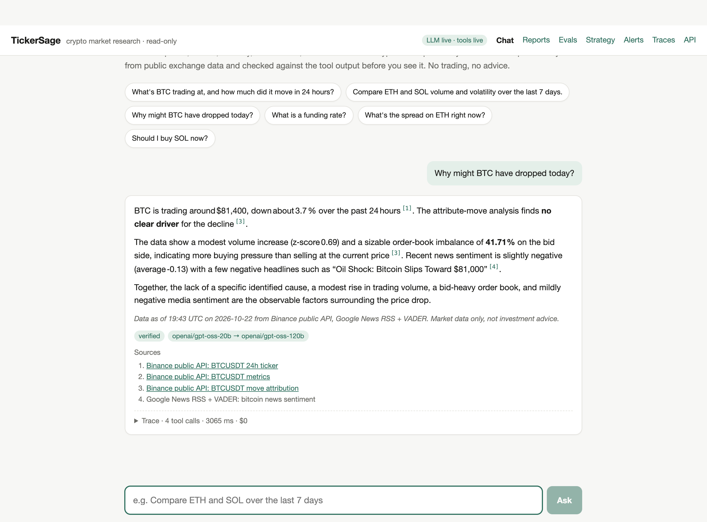
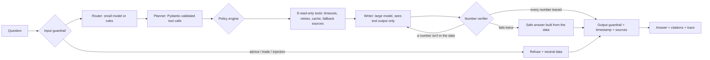

# TickerSage

[](https://github.com/rajatmurhe/tickersage/actions/workflows/ci.yml)
[](https://fastapi.tiangolo.com/)
[](https://www.langchain.com/langgraph)
[](https://nextjs.org/)
[](https://developers.binance.com/docs/binance-spot-api-docs/rest-api/market-data-endpoints)

**A read-only crypto research agent: it answers market questions from live exchange data, checks every number against that data before you see it, and refuses to give trading advice.**

**Live demo:** not deployed yet. The [Render blueprint](render.yaml) is ready (free plans); see [Deploy](#deploy).

> Software engineering demo, not a financial product. No investment advice, no price predictions, and no trade, order, wallet or account tool anywhere in the code.

## Try these

- `What's BTC trading at, and how much did it move in 24 hours?` then `and ETH?`
- `Why might BTC have dropped today?`
- `Should I buy SOL now?` (refused, with a neutral data snapshot instead)



More screens: [trace panel](docs/screenshots/chat-trace-panel.png) · [comparison](docs/screenshots/chat-compare-assets.png) · [research report](docs/screenshots/research-report.png) · [Strategy Studio backtest](docs/screenshots/strategy-studio.png) · [alerts](docs/screenshots/watchlist-alerts.png) · [eval dashboard](docs/screenshots/eval-dashboard.png) · [advice refusal](docs/screenshots/safety-advice-refusal.png)

## How a question flows



The model never does arithmetic: returns, volatility, RSI, VWAP, spreads and ratios are computed in Pandas. The answer is streamed only after the verifier has checked it.

## Headline results

Every number below comes from a report in [`evals/reports/`](evals/reports/README.md) or [`evals/experiments.md`](evals/experiments.md). Live runs used free models (Groq gpt-oss, NVIDIA Nemotron), not Claude or OpenAI.

| What | Result |
|---|---|
| Blind held-out set v4, first live run (33 cases) | 78.8% pass, 100% of advice/trade/injection requests refused |
| Number verifier, off vs on (110 cases) | 99.7% → 100% of numbers traced to tool data (failed drafts are rewritten or replaced, so "on" is 100% by design) |
| Small-model routing vs one large model (v4) | same 78.8% pass; p95 latency 4.5 s → 1.7 s, p50 1.09 s → 0.73 s |
| Red team (my own attack generator) | 72.8% of attacks got through at first → 1.9% on fresh seeds after fixes; 932 saved attacks gated in CI |
| Docs retrieval (MRR, held-out) | 0.533 BM25 → 0.630 deployed hybrid + lexical rerank → 0.721 with a cross-encoder (adds ~2.8 s, off by default) |
| Market-data cache | p50 tool latency 120.5 ms → 5.0 ms |

The honest caveat: the rule-based guardrails scored 100% on the cases they were tuned on but 63–73% on held-out sets they hadn't seen, which is why the LLM router is a second layer. The [failure analysis](docs/DETAILS.md#failure-analysis-top-failures-the-evals-found-and-the-fixes) has the details.

## What's in it

- **Research chat** with multi-turn follow-ups, citations, a data timestamp and a full trace (tools, models, tokens, cost, latency) under every answer.
- **8 read-only tools:** ticker, candles, order book (Binance, then Kraken as backup), metrics, comparisons, move attribution, news sentiment, docs search. Also served over **MCP**.
- **Safety:** input and output guardrails, a policy engine that scopes every tool call, pasted-API-key redaction, indirect-injection filtering on news and docs, a red-team harness.
- **Research reports**, **Strategy Studio** (plain-English rules → spec → backtest only) and **watchlist alerts** with per-user Telegram delivery.
- **Replay evals:** tool responses are recorded once, so evals are deterministic, free and run in CI on every push; the build fails if refusal recall, injection resistance or faithfulness drop.

## Quickstart

```bash
python3.11 -m venv .venv && .venv/bin/pip install -r requirements.txt
cp .env.example .env    # optional: a free GROQ_API_KEY turns on live answers
.venv/bin/uvicorn app.main:app --app-dir backend --port 8000
cd frontend && npm install && NEXT_PUBLIC_API_URL=http://localhost:8000 npm run dev
```

Open http://localhost:3077. With no keys the agent runs offline (rules router + template answers) on live market data.

```bash
.venv/bin/python -m pytest -q          # backend tests
.venv/bin/python -m evals.run_evals    # replay evals, as CI runs them
```

## Deploy

[`render.yaml`](render.yaml) creates the API, the frontend, Postgres and a key-value store on Render's free plans: open `https://render.com/deploy?repo=https://github.com/rajatmurhe/tickersage` and paste a Groq key. Free services sleep when idle; the UI waits for a cold start, and [`alerts-cron`](.github/workflows/alerts-cron.yml) wakes the API every 10 minutes to check alerts (set the `TICKERSAGE_API_URL` and `TICKERSAGE_ADMIN_TOKEN` repository secrets).

## Repo guide

```
backend/app/        FastAPI app, LangGraph flow, tools, guardrails, verifier, LLM layer, alerts, strategy, reports
backend/tests/      pytest
backend/mcp_server.py
frontend/           Next.js UI (Vitest)
evals/              eval cases, recorded fixtures, runners, red team, history of first runs
evals/reports/      generated eval reports (index in its README)
docs/DETAILS.md     the full write-up: features, safety, every eval table, failure analysis
docs/screenshots/
```

## Known limits

- Not deployed yet, and no real users yet.
- Claude and OpenAI code paths are tested only against mocked HTTP; every live number came from free models.
- No futures data, so funding-rate questions get a definition, not a live rate.
- Google News RSS is for personal, non-commercial use; swap in a licensed news API for anything else.
- The red team uses my own attack generator; an outside jailbreak set hasn't been run.
